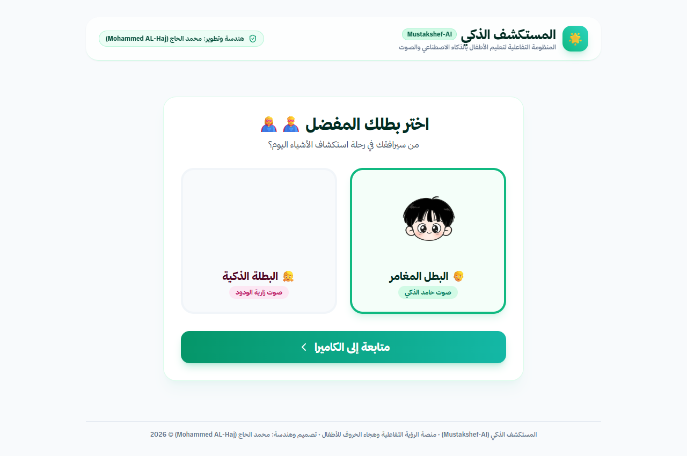
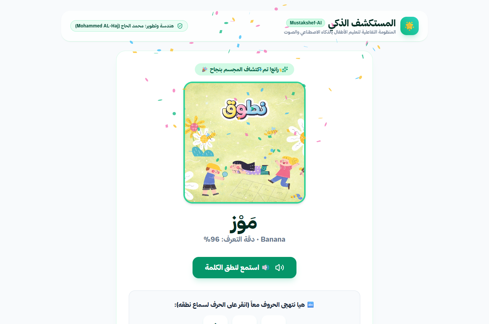

# المستكشف | Mustakshef-AI

<div align="center">

[](https://github.com/alhaj-ai/Mustakshef-AI/actions)
[](https://github.com/alhaj-ai/Mustakshef-AI/releases)


**تطبيق تفاعلي للتعرف البصري على الأشياء وتقسيمها عبر `YOLOv8-seg` عبر 82 فئة عربية، مع تهجئة الحروف ونطق عصبي عربي عبر `Edge TTS`**  
*Interactive Computer Vision & Arabic Audio Learning System: YOLOv8 Instance Segmentation, RTL Visual Overlay & Neural Phonics*

</div>

---

## 📌 ما يفعله النظام (System Capabilities)

يدمج **المستكشف (`Mustakshef-AI`)** نموذج تقسيم بصري (`YOLOv8-seg`) مع محرك نطق وتفكيك هجائي عربي عبر واجهتي **Next.js 14** و**Streamlit**:

1. **تجزئة وتصنيف المجسمات عبر 82 فئة عربية (`YOLOv8-seg`)**: قصّ تلقائي لمنتصف الإطار، استدلال بالذكاء الاصطناعي (`task="segment"`, `conf=0.25`)، ورسم قناع التجزئة مع شارة اسم عربية مضبوطة بالاتجاه (`arabic_reshaper` + `python-bidi` + خط `NotoNaskhArabic-Regular.ttf`).
2. **حالة صادقة عند غياب الاكتشاف**: إذا لم يتجاوز أي جسم حد الثقة، يرجع الخادم `detected: false` مع حفظ الإطار المعلّم بدلاً من افتراض تصنيف وهمي.
3. **التهجئة والتوليد الصوتي المتوازي (`Arabic Phonics + Edge TTS`)**: إزالة التشكيل من الكلمة (`spell_word`), ربط كل حرف باسمه العربي الكامل (`ARABIC_LETTER_NAMES`)، وتوليد المقاطع الصوتية للكلمة والحروف بالتوازي (`asyncio.gather`) عبر أصوات `ar-SA-ZariyahNeural` و`ar-SA-HamedNeural` مع مسار احتياطي عبر HTTP TTS.
4. **واجهتا عرض متكاملتان**: واجهة أمامية بـ **Next.js 14** (`frontend/src/app/page.tsx`) تدعم الكاميرا المباشرة ورفع الصور وحالات التحميل والخطأ والانتقال لوضع معاينة تعليمية مستقل عند توقف الخادم، إلى جانب تطبيق **Streamlit** (`interactive_explorer/explorer_app.py`).

---

## 🎬 واجهة API والاختبارات

### 1. نقطة نهاية التحليل البصري والصوتي (`POST /segment`):

```bash
curl -X POST "http://localhost:8000/segment?voice=ar-SA-ZariyahNeural" \
  -F "file=@sample.jpg"
```

**بنية الاستجابة الفعلية (`DetectionResponse`):**
```json
{
  "detected": true,
  "label_ar": "تفاحة",
  "label_en": "Apple",
  "confidence": 0.92,
  "inference_ms": 24.1,
  "spelling": ["ت", "ف", "ا", "ح", "ة"],
  "spelling_details": [
    { "letter": "ت", "name": "تاء", "audio": "data:audio/mp3;base64,..." }
  ],
  "annotated_image": "data:image/jpeg;base64,...",
  "audio_word": "data:audio/mp3;base64,..."
}
```

### 2. نقاط النهاية المتاحة:

| المسار | الطريقة | الوظيفة |
| :--- | :--- | :--- |
| `/` | `GET` | معلومات الخدمة وعدد الفئات (`82`) |
| `/health` | `GET` | فحص جاهزية الخادم والنموذج (`healthy` / `degraded`) |
| `/labels` | `GET` | استعراض جدول الفئات الـ 82 بالإنجليزية والعربية |
| `/segment`, `/api/segment` | `POST` | قص الصورة وتشغيل `YOLOv8-seg` وتوليد التهجئة والصوت |
| `/api/tts` | `GET` | توليد مقطع MP3 لصوت عربي أو حرف وفق قائمة الأصوات المعتمدة |

### 3. التشغيل والتحقق الآلي (`pytest` + `Next.js Build`):

```bash
# تشغيل اختبارات الخادم والتهجئة والتحقق من المدخلات
pytest -v backend/tests

# التحقق من أنواع TypeScript وبناء واجهة Next.js
cd frontend && npm run lint && npm run build
```

---

## 📸 معرض الواجهة الفعلي (Screenshots)

<div align="center">

| الشاشة الترحيبية | اختيار الشخصية والصوت |
| :---: | :---: |
|  |  |

| التصوير ورفع الصورة | نتائج التجزئة والهجاء |
| :---: | :---: |
|  |  |

</div>

---

## 🚀 دليل التشغيل (Quick Start)

### 1. خادم الذكاء الاصطناعي (`FastAPI Backend`)

يحمّل الخادم أوزان النموذج تلقائياً عند التشغيل من إصدار [`v1.0.0`](https://github.com/alhaj-ai/Mustakshef-AI/releases/tag/v1.0.0) إذا لم تكن موجودة محلياً في `backend/models/best.pt`:

```bash
cd backend
python -m venv .venv
.venv\Scripts\activate   # على Linux/macOS: source .venv/bin/activate
pip install -r requirements.txt
uvicorn main:app --host 0.0.0.0 --port 8000 --reload
```

### 2. الواجهة الأمامية (`Next.js 14`)

```bash
cd frontend
npm install
# اختياري: ضبط NEXT_PUBLIC_BACKEND_URL إذا كان الخادم على مضيف آخر (الافتراضي http://localhost:8000)
npm run dev
```

الرابط: `http://localhost:3000`

### 3. البديل التفاعلي عبر Streamlit (اختياري)

```bash
cd interactive_explorer
pip install -r requirements.txt
streamlit run explorer_app.py
```

---

## 📄 الترخيص (License)

مرخص تحت رخصة **MIT**. راجع ملف [LICENSE](LICENSE).

<div align="center">

**المستكشف (`Mustakshef-AI`)** — تصميم وهندسة: **محمد الحاج (`Mohammed AL-Haj`)** © 2026

</div>
