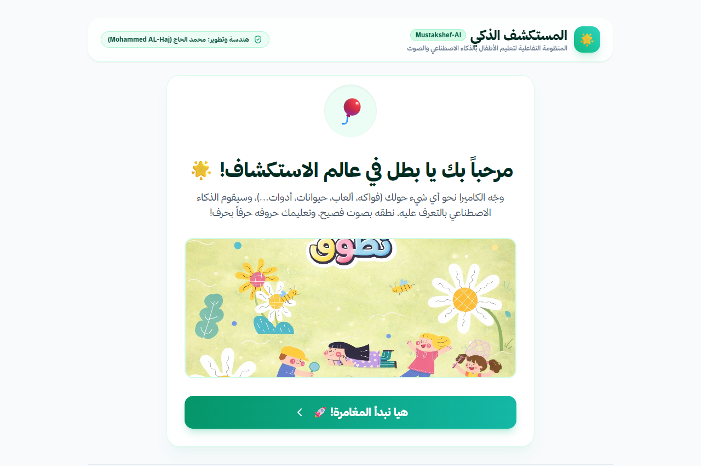
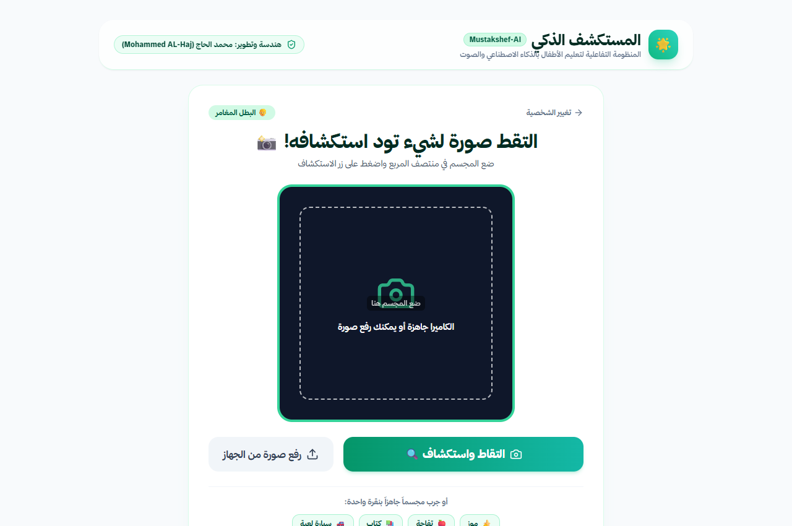

# 🌟 المستكشف الذكي | Mustakshef-AI

<div align="center">


**منظومة تفاعلية ذكية للأطفال تجمع بين الرؤية الحاسوبية (Computer Vision)، ونماذج YOLO لتجزئة الكائنات، والتعلم الصوتي التفاعلي باللغة العربية الفصحى.**

[✨ تجربة الواجهة التفاعلية](#-واجهات-التطبيق-المزدوجة) • [🧠 المعمارية التقنية](#-المعمارية-التقنية) • [🚀 التشغيل السريع](#-دليل-التشغيل) • [📸 لقطات الشاشة](#-معرض-الشاشات)

</div>

---

## 📖 نظرة عامة (Overview)

**المستكشف الذكي (Mustakshef-AI)** هو نظام تعليمي تفاعلي حديث صُمم خصيصاً للأطفال في مرحلة الاستكشاف المبكر (5 إلى 10 سنوات). يعمل النظام على تحويل البيئة المحيطة بالطفل إلى رحلة تعليمية شيقة:

1. **التقاط الصورة**: يوجه الطفل الكاميرا نحو أي مجسم حوله (فاكهة، لعبة، كتاب، أدوات...).
2. **التعرف والتجزئة البصرية**: يقوم نموذج الذكاء الاصطناعي (YOLOv8 Segmentation) بتحديد المجسم وعزل أبعاده بدقة فائقة.
3. **النطق الصوتي الطبيعي**: يُنطق اسم المجسم بالصوت العربي العصبي الطبيعي فائق النقاء.
4. **هجاء الحروف التفاعلي**: يتفكك اسم الكلمة إلى بطاقات حروف تفاعلية قابلة للنقر، ليستمع الطفل لنطق كل حرف على حدة مع مؤثرات بصرية مبهجة.

---

## 📸 معرض الشاشات (Visual Showcase)

<div align="center">

### 1. شاشة الترحيب وبدء المغامرة


### 2. اختيار الشخصية والأفاتار (بطل / بطلة)


### 3. شاشة الكاميرا وتحديد المجسم (Viewfinder)


### 4. شاشة الاكتشاف والتعلم وهجاء الحروف التفاعلي


</div>

---

## 🎨 واجهات التطبيق المزدوجة (Dual Frontends)

يحتوي المشروع على خيارين متكاملين للواجهة لتناسب جميع سيناريوهات الاستخدام:

| الواجهة | التقنية | المزايا | مسار التشغيل |
|---|---|---|---|
| **الواجهة الحديثة (Web App)** | **Next.js 14 + Tailwind + TypeScript** | دعم كامل لخط ثمانية (Thmanyah Bold)، حركات تفاعلية، بطاقات هجاء ناطقة، احتفاليات صوتية وبصرية. | `cd frontend && npm run dev` |
| **واجهة الاستكشاف السريع (Explorer)** | **Streamlit Python** | تشغيل فوري بدون تثبيت Node.js، واجهة بسيطة ومحببة للأطفال، تدعم الكاميرا والرفع المباشر. | `cd interactive_explorer && streamlit run explorer_app.py` |

---

## 🧠 المعمارية التقنية ومواصفات النموذج

- **نموذج الرؤية (Computer Vision)**:
  - نموذج مخصص مبني على معمارية **YOLOv8-Seg** التجزئية (`best.pt`).
  - مدرب على **82 فئة شائعة** من اهتمامات الأطفال اليومية (حيوانات، أطعمة وفواكه، وسائل نقل، أدوات مدرسية، ألعاب).
- **محرك النطق الصوتي (Neural TTS Engine)**:
  - أصوات عصبية فائقة الوضوح موجهة للأطفال (`ar-SA-ZariyahNeural` و `ar-SA-HamedNeural`).
  - معالجة خاصة لأسماء الحروف الفردية المنفصلة (تحويل "ب" إلى "باء") لنطق تربوي فصيح.
- **خادم الواجهة الخلفية (Backend)**:
  - مبني بـ **FastAPI** السريع مع دعم العمليات اللاتزامنية بالكامل (Asynchronous).
  - توثيق تفاعلي تلقائي عبر Swagger UI على المسار `/docs`.

---

## 🚀 دليل التشغيل (Quick Start)

### 1️⃣ تشغيل خادم الذكاء الاصطناعي (FastAPI Backend)

```bash
cd backend
python -m venv .venv
# على ويندوز:
.venv\Scripts\activate
# على لينكس/ماك:
source .venv/bin/activate

pip install -r requirements.txt
python -m uvicorn main:app --host 0.0.0.0 --port 8000 --reload
```

سيكون الخادم متاحاً وتفاعلياً على: `http://localhost:8000`

---

### 2️⃣ الخيار الأول: تشغيل واجهة الويب الحديثة (Next.js 14)

```bash
cd frontend
npm install
npm run dev
```

افتح المتصفح على: `http://localhost:3000`

---

### 3️⃣ الخيار الثاني: تشغيل واجهة الاستكشاف (Streamlit App)

```bash
cd interactive_explorer
pip install -r requirements.txt
streamlit run explorer_app.py
```

افتح المتصفح على: `http://localhost:8501`

---

## 🛠️ نقاط النهاية الرئيسية (API Endpoints)

| المسار | الطريقة | الوصف |
|---|---|---|
| `/` | `GET` | معلومات حالة النظام والإصدار |
| `/health` | `GET` | فحص جاهزية نموذج الـ YOLO والمكونات |
| `/labels` | `GET` | قائمة الفئات الـ 82 المدعومة مع الترجمة العربية المعتمدة |
| `/segment` | `POST` | رفع الصورة، معالجة التجزئة، وتوليد النطق الصوتي والهجاء |
| `/api/tts` | `GET` | توليد مقطع صوتي فوري لأي كلمة أو حرف عربي |

---

## 📄 الترخيص (License)

هذا المشروع مرخص تحت رخصة **MIT**. راجع ملف [LICENSE](LICENSE) لمزيد من التفاصيل.

---

<div align="center">

**المستكشف الذكي (Mustakshef-AI)**  
هندسة وتطوير: **محمد الحاج (Mohammed AL-Haj)** © 2026

</div>
